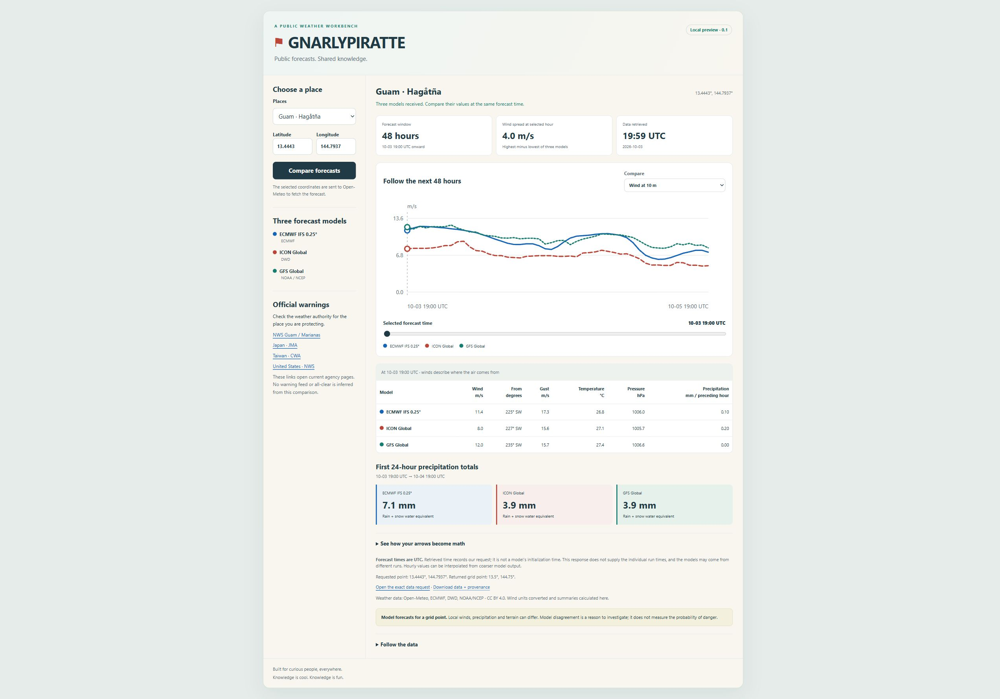

# GNARLYPIRATTE

An open-source Windy weather-panel prototype, with a shared panel that also runs in a
standalone local preview. Original GNARLYPIRATTE code is MIT licensed. Weather
data, Windy services, and dependencies retain their own terms and attribution.

Source: [pcheek1991/GNARLYPIRATTE](https://github.com/pcheek1991/GNARLYPIRATTE). The panel footer links to this repository.



## What the panel does

Choose Guam, Pagan, Ogasawara, Taipei, Miami, or custom coordinates, then compare
three model forecasts delivered by Open-Meteo:

| Model | Open-Meteo model ID | Provider |
| --- | --- | --- |
| ECMWF IFS 0.25° | `ecmwf_ifs025` | ECMWF |
| ICON Global | `icon_global` | DWD |
| GFS Global | `gfs_global` | NOAA / NCEP |

The request uses `/v1/forecast`, `forecast_hours=49`, `timezone=UTC`, and
`cell_selection=nearest`. All displayed times are UTC. The panel shows the
returned hourly values in a chart, a time slider, and a table. You can switch
the chart between wind speed, precipitation, temperature, and sea-level
pressure. Wind direction and gusts appear in the table.

The response has 49 hourly timestamps, spanning 48 hours from the first to the
last timestamp. Requests time out after 20 seconds rather than staying in a
loading state indefinitely.

| Quantity | Display unit | Meaning |
| --- | --- | --- |
| Wind and gusts at 10 m | m/s | Direction is the bearing the wind comes from |
| Temperature at 2 m | °C | Forecast air temperature |
| Mean sea-level pressure | hPa | Pressure reduced to sea level |
| Precipitation | mm | Total precipitation for the preceding hour |

The precipitation field includes rain, showers, and snow water equivalent.
The first 24-hour total adds indices 1 through 24, representing intervals
after the first timestamp through the timestamp 24 hours later. It excludes
index 0, which belongs to the preceding interval. A missing amount makes the
total unavailable rather than zero. These variable definitions follow
[Open-Meteo's forecast documentation](https://open-meteo.com/en/docs).

Model spread is the largest minus the smallest wind speed at the same selected
forecast time. It is a difference between model outputs, not a probability,
a confidence interval, or an alert level. Missing values remain unavailable.
Wind components use the meteorological "from" direction:
`u = -speed × sin(direction)` and `v = -speed × cos(direction)`.

The initial panel load requests a forecast. Location changes and the Compare
forecasts button trigger subsequent requests; there is no timed polling. An
in-memory cache reuses the same exact request for ten minutes and retains at
most 30 requests. The cache does not persist after the page is closed. The
selected coordinates are sent to Open-Meteo; no account or API key is used.

The provenance section shows the exact request, requested and returned grid
coordinates, retrieval time, and data attribution. Download data + provenance
exports the raw response together with normalized values and provenance as
JSON. Retrieval time records this request. Individual model initialization
times are explicitly unknown; they are not inferred from retrieval time or
the API's processing-duration field. Hourly data may interpolate coarser model
output, and different models may reflect different runs.

Official-warning links lead to NWS Guam/Marianas, JMA, Taiwan CWA, and the U.S.
NWS. The starter does not ingest a warning feed or infer an all-clear. It does
not track storm-center positions.

## Standalone preview

Run this after installing dependencies:

```sh
npm run preview
```

Open [http://127.0.0.1:8765/](http://127.0.0.1:8765/). This uses the same panel,
styles, forecast requests, calculations, and export as the Windy wrapper. It
does not require a Windy account. The server listens on localhost and serves
`preview.html`; it does not provide the Windy map-center action. Stop the
server with Ctrl+C.

## Windy integration

The wrapper follows the [official Windy plugin guide](https://docs.windy-plugins.com/getting-started/)
and [current official template](https://github.com/windycom/windy-plugin-template).
It uses Svelte lifecycle hooks and Windy's documented client modules:

- Opening GNARLYPIRATTE shows a right-side panel on desktop and a full-screen
  panel on mobile.
- The initial point is Windy's current map center. A map click or the panel's
  map-center action chooses another point. Opening from the map context menu
  or a route with coordinates passes that point into the same panel.
- Map clicks are subscribed through
  [`@windy/singleclick`](https://docs.windy-plugins.com/api/modules/singleclick.html).
  The listener, shared stylesheet, and panel are cleaned up when it closes.
- [`@windy/location`](https://docs.windy-plugins.com/api/modules/location.html)
  updates the plugin route when the user chooses another point.
- The config sets `private: true`. No publication, account setup, user-account
  access, or installation in Windy was performed to produce this starter.

## Build and local development

Use Node.js 20 or later. In this directory:

```sh
npm ci
npm run check
npm test
npm run build
```

`check` validates the TypeScript plugin configuration against Windy's types.
`build` compiles the Svelte wrapper and shared panel through the official
`@windycom/plugin-devtools` transform and produces:

- `dist/plugin.js` and its source map
- `dist/plugin.min.js`
- `dist/plugin.json`, generated by Windy's build transform
- `dist/package.json`
- `dist/LICENSE` and `dist/THIRD_PARTY_NOTICES.md`, including the bundled
  Svelte runtime's license notice

The build command works on Windows and other Node.js platforms; it does not
launch a server or publish anything.

The official template's optional SWC compiler step is replaced here by
TypeScript's JavaScript implementation. This avoids a native-addon loading
failure observed on this Windows host while retaining the documented
Svelte/Rollup/plugin-devtools architecture.

The eight focused weather tests cover wind-vector direction, missing values,
the 24-hour precipitation boundary, units, hourly time alignment, model spread,
unknown initialization time, and invalid coordinates. The full build and
configuration checks passed locally. Runtime behavior inside Windy's client
requires the separate developer-mode test below.

For the optional Windy development server:

```sh
npm start
```

This watches the source files and serves the plugin at
[https://localhost:9999/plugin.js](https://localhost:9999/plugin.js). It listens
on localhost. The HTTPS certificate is the public development certificate
supplied by Windy's devtools package.

To test the integration yourself, follow
[Windy's developer-mode instructions](https://docs.windy-plugins.com/getting-started/debugging.html):
open the local HTTPS URL and accept its development certificate, then open
[Windy developer mode](https://www.windy.com/developer-mode) and load that URL.
Loading the plugin there is a separate user-operated step. A successful local
build does not establish that it has been loaded or exercised in Windy.

## Shared panel contract

`src/plugin.svelte` imports `src/panel.js` and `src/panel.css`. A small Rollup
transform imports the CSS as text. The wrapper adds it as a `<style>` element
beside the panel host, then removes it on close. Panel CSS is namespaced under
`.gnarlypiratte` so it does not restyle the Windy application.

```js
const panel = mountPanel(host, {
  initialLocation: { latitude, longitude },
  locationLabel: 'Windy map center',
  onUseMapCenter: () => { /* choose the current documented map center */ },
});
panel.setLocation({ latitude, longitude }, 'Selected map point');
panel.destroy();
```

The wrapper converts documented Windy `{lat, lon}` events and LeafletGL
`{lat, lng}` centers into the shared coordinate shape. It checks latitude and
normalizes longitude before handing them to the panel. It does not inspect
Windy's private application state or scrape Windy weather data.

## Data, attribution, and limits

Keep the panel's attribution to Open-Meteo, ECMWF, DWD, and NOAA/NCEP visible,
and preserve attribution in exported data. Open-Meteo's API data is offered
under [CC BY 4.0](https://open-meteo.com/en/licence); attribution must include a
license link and indicate changes. This starter requests wind in m/s and
calculates the displayed summaries. Original code remains reusable under MIT.

The free hosted Open-Meteo endpoint is for noncommercial use and is
rate-limited. The [provider's terms](https://open-meteo.com/en/terms) currently
state less than 10,000 calls per day, 5,000 per hour, and 600 per minute; consult
those terms before a deployment. The starter's cache limits repeat traffic
but does not promise compliance for a public deployment. No commercial
service plan or external account is configured here.

Open-Meteo's server software is separately
[AGPLv3 or later](https://github.com/open-meteo/open-meteo). It is not bundled
with this client. Self-hosting that server would be a separate project under
its own license and dependencies.

Provider API availability, geographic/model coverage, and grid resolution
affect the live panel. Forecast values describe returned model data, rather
than a separate physical observation. If a request fails, the panel displays
the failure and does not substitute a zero forecast or a fabricated result.

Windy's documented plugin API and build tools can change independently of this
starter. The installed `@windycom/plugin-devtools` version is pinned at 3.0.4,
and exact resolved dependencies are captured in `package-lock.json`. Some
upstream dependencies currently emit deprecation notices during installation.

See [LICENSE](LICENSE) for original-code licensing and
[THIRD_PARTY_NOTICES.md](THIRD_PARTY_NOTICES.md) for template and dependency
provenance. Third-party public plugin source is not included in this starter.

## Dependency review

Compatible dependency updates were applied and the build was rechecked. Upstream advisories remain in the official build tooling and Svelte 4 runtime; see [DEPENDENCY-NOTES.md](DEPENDENCY-NOTES.md) for the exact versions, feature exposure and limits of this review.
